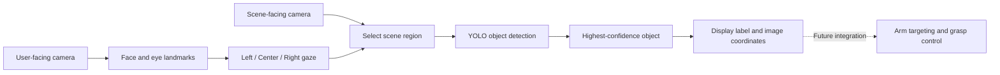

# Gaze-Guided Object Selection for a Prosthetic Arm

A two-camera computer vision prototype developed as a component of our **Smart India Hackathon (SIH) 2025** prosthetic-arm project.

The wider project aimed to let a user select an object by looking toward it through a glasses-based interface, so that a prosthetic arm could reach for and grasp it. This repository contains the vision component: it estimates the user's gaze direction, detects objects in the corresponding scene region, and displays a candidate target with its image coordinates.

Although the repository is named `gaze_img_classification`, the implemented task is **gaze-guided object detection and selection**: objects receive both a class label and a bounding box.

## Project overview

The intended glasses setup has two views:

- **User-facing camera:** observes the user's face and eyes to estimate gaze direction.
- **Scene-facing camera:** observes the objects in front of the user.

The prototype uses dlib's facial landmarks and eye-region thresholding to estimate **Left**, **Center**, or **Right** gaze. It then runs an Ultralytics YOLO detector on the selected region of the scene and highlights the detection with the highest confidence. A Tkinter interface displays both feeds, gaze information, the object label, and bounding-box coordinates.



**Current scope:** this is a desktop vision prototype. It does not include glasses hardware integration, camera-to-arm calibration, depth estimation, inverse kinematics, motor control, or a completed grasping pipeline. Bounding-box coordinates are pixels in the resized scene image, not positions the arm can directly move to.

## Features

- Two live camera feeds in one desktop window.
- Eye-region overlays and coarse horizontal gaze estimation.
- Blink indication based on eye landmark geometry.
- Gaze-dependent scene regions: left half, right half, or the full frame for center gaze.
- Highest-confidence object selection within the chosen region.
- Object label, confidence, and bounding-box coordinates in the scene view.
- Camera indices and detector checkpoint configurable from the command line.
- No target selection when a face/gaze estimate is unavailable.

## Repository contents

| File | Purpose |
| --- | --- |
| `main.py` | Camera capture, gaze-guided detection, and Tkinter interface |
| `gaze_tracker.py` | dlib face landmarks, blink indication, and gaze estimation |
| `requirements.txt` | Direct Python dependencies |
| `.gitignore` | Excludes environments, model assets, archives, and local configuration |

Model assets and the original ZIP backup are intentionally excluded from version control. Existing local copies can remain alongside the source files.

## Setup

Use a desktop Python environment with Tkinter, two accessible cameras, and enough processing capacity to run YOLO inference. Python 3.10 or newer is a starting point; dependency versions are not locked, and a fully tested compatibility matrix is not available.

### 1. Create an environment

```bash
git clone https://github.com/raj-aryan25/gaze_img_classification.git
cd gaze_img_classification
python -m venv .venv
```

Activate it on Linux/macOS:

```bash
source .venv/bin/activate
```

Or in Windows PowerShell:

```powershell
.\.venv\Scripts\Activate.ps1
```

Install dependencies:

```bash
python -m pip install --upgrade pip
python -m pip install -r requirements.txt
```

Tkinter is a system Python component, not a pip dependency. If it is missing on Ubuntu/Debian, install `python3-tk`. dlib may require CMake and a C++ compiler when a compatible wheel is unavailable; on Ubuntu/Debian these are typically supplied by `cmake` and `build-essential`. Windows source builds may require the Visual Studio C++ build tools.

### 2. Prepare the model assets

Place the following files next to `main.py`:

```text
gaze_img_classification/
├── main.py
├── gaze_tracker.py
├── requirements.txt
├── shape_predictor_68_face_landmarks.dat
└── yolov5su.pt
```

**Facial landmark predictor:** download the [dlib 68-point landmark model](https://dlib.net/files/shape_predictor_68_face_landmarks.dat.bz2), decompress the `.bz2` archive, and place the resulting `.dat` file in the project folder. See the [official dlib example](https://dlib.net/face_landmark_detection.py.html) for model details and usage restrictions.

**Object detector:** the default checkpoint filename is `yolov5su.pt`, a [YOLOv5u model supported by Ultralytics](https://docs.ultralytics.com/models/yolov5/). If you do not already have it, run this command from the project folder to obtain the standard pretrained checkpoint:

```bash
python -c "from ultralytics import YOLO; YOLO('yolov5su.pt')"
```

The download requires internet access. Existing checkpoint files are not verified or replaced by this repository. A custom compatible detector can be supplied with `--model`.

### 3. Run the interface

Connect one camera facing the user's face and another facing the scene, then run:

```bash
python main.py
```

The default camera indices are `0` for gaze and `1` for the scene. To swap them:

```bash
python main.py --gaze-camera 1 --scene-camera 0
```

To use another detector checkpoint:

```bash
python main.py --model /path/to/detector.pt
```

Keep one face visible in the user-facing camera and use steady lighting. Look left, center, or right and observe the candidate object in the scene view. Close the window to release the cameras.

If either camera cannot open, check its index, operating-system camera permissions, and whether another application is using it. A graphical desktop is required; the Tkinter interface will not run in a headless terminal alone.

## How selection works

1. Detect a face and its 68 facial landmarks.
2. Extract the eye regions and compare thresholded white-pixel counts between their left and right halves.
3. Average the two eye ratios and classify gaze as Left, Center, or Right using fixed thresholds.
4. Crop the corresponding scene region: left half, right half, or the entire frame.
5. Run YOLO and choose the returned bounding box with the highest confidence.
6. Map the box back into the full scene image and display it with its class label.

Eye-center coordinates shown in the interface are centers of landmark-defined eye regions, not measured pupil positions. Gaze direction labels depend on camera placement and image orientation and may need calibration for a particular setup.

## Limitations and future work

This is a coarse gaze-selection demonstration, rather than calibrated point-of-gaze tracking. The highest-confidence object in a region may differ from the user's intended object, particularly when several objects appear in the same half of the scene. Center gaze searches the full image, not a narrow center region.

Lighting, face pose, glasses reflections, camera alignment, and fixed thresholds can affect gaze estimation. Blink detection provides a visual indication; it is not a selection-confirmation gesture or a selection lockout. Processing is synchronous, so interface responsiveness depends on inference speed. No measured accuracy, latency, or real-world grasping results are included.

Further work could add per-user gaze calibration, stable dwell-based selection, explicit target confirmation, depth sensing, coordinate transforms into the arm's reference frame, and integration with the arm controller.

## Acknowledgments

Built as the gaze-guided vision component of our SIH 2025 prosthetic-arm project.

The implementation uses [OpenCV](https://opencv.org/), [dlib](https://dlib.net/), [Ultralytics](https://docs.ultralytics.com/), [NumPy](https://numpy.org/), [Pillow](https://python-pillow.org/), and Python's Tkinter. External libraries, datasets, and model weights retain their respective licenses and usage terms. In particular, dlib's landmark-model documentation identifies restrictions inherited from its training dataset.
